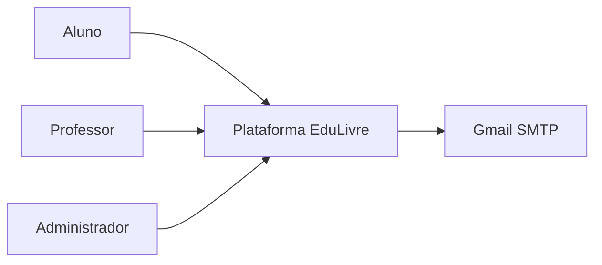
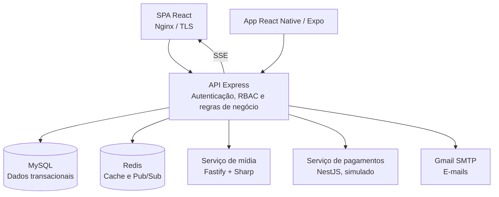
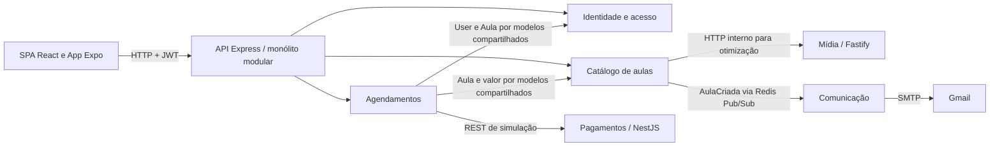

# Arquitetura do EduLivre

## C4 — Contexto

O EduLivre conecta alunos a professores particulares. Alunos pesquisam, contratam e pagam aulas; professores publicam e administram aulas; administradores moderam conteúdo e enviam comunicados operacionais.

## C4 — Contêineres

O diagrama inclui os dois clientes presentes no repositório (`EduLibre_FrontEnd-main` e `EduLibre_Mobile`). A API, os contextos centrais e o MySQL formam o núcleo implantado em conjunto; mídia e pagamentos têm processos Docker próprios.

## Estilo arquitetural, domínios e subdomínios

O núcleo é um **monólito modular**: API, regras de negócio e persistência compartilham o mesmo deploy para simplificar as transações de usuários, aulas, avaliações e agendamentos. As capacidades de mídia e pagamento simulado foram extraídas para serviços independentes.

| Subdomínio | Classificação | Bounded context | Responsabilidades e elementos principais |
| --- | --- | --- | --- |
| Marketplace de aulas | Core | Catálogo de aulas | Publicar, pesquisar e moderar aulas; `Aula`, `Avaliacao`, valor monetário |
| Contratação de aulas | Core | Agendamentos | Solicitar, aceitar/recusar e pagar reservas; `Agendamento`, estados da reserva e pagamento |
| Identidade e acesso | Genérico | Identidade e acesso | Cadastro, login, RBAC e recuperação de senha; `User`, `Role`, `Permission` |
| Comunicação | Supporting | Comunicação | Notificações persistentes e ao vivo, comunicados e e-mail; `Notificacao`, Redis Pub/Sub, SSE e SMTP |
| Otimização de imagens | Genérico | Mídia | Validar e converter imagens para WebP; arquivo, MIME type e tamanho |
| Autorização simulada | Supporting | Pagamentos | Simular aprovação/recusa Pix ou cartão; `transactionId`, método e valor |

### Context Map

As setas mostram dependências e o mecanismo de integração usado no desenho atual. Identidade, catálogo e agendamentos são fronteiras lógicas dentro do mesmo monólito, não serviços implantados separadamente.

### Entidades, Value Objects e Aggregate — contexto Agendamentos

- **Entidades identificadas:** `Agendamento` (raiz do aggregate), `User` e `Aula` (entidades referenciadas por ID, pertencentes a outros contextos) e a transação de pagamento registrada no agendamento.
- **Value Objects conceituais:** `BookingStatus` (`pendente`, `aceito`, `recusado`), `PaymentStatus` (`pendente`, `pago`), método (`pix`, `card`), data futura e valor monetário positivo. No código, são valores/tipos validados; não há classes Value Object dedicadas.
- **Aggregate `Agendamento`:** a raiz é responsável pelo estado da reserva e pelos dados de auditoria do pagamento (`paymentTransactionId`, `paymentMethod`, `paymentPaidAt`). `User` e `Aula` são referências externas ao aggregate, não objetos que ele possui.
- **Invariantes:** somente o aluno dono paga; a reserva precisa estar aceita antes do pagamento; não se pode recusar uma reserva paga; somente o professor da aula pode decidir; e reservas alteradas precisam ser futuras. A autorização simulada aprovada é persistida antes de retornar sucesso.

No código atual, `Agendamento` é um model Sequelize e as regras ficam em `AgendamentoService`; a definição acima explicita a fronteira lógica do aggregate, não afirma que exista uma classe de domínio separada.

## Modelo de dados e ADRs

O MySQL é a fonte de verdade de usuários, aulas, reservas, avaliações, permissões e auditoria de pagamento. Redis é infraestrutura efêmera para cache com TTL e Pub/Sub, não a fonte de verdade. O serviço de mídia é stateless; o serviço de agendamentos persiste o resultado auditável do pagamento.

### ADR-001 — Monólito modular com microsserviços pontuais

- **Contexto:** regras de catálogo e agendamento são fortemente relacionadas, mas mídia e pagamento têm características próprias.
- **Decisão:** manter o núcleo no Express modular e separar mídia/pagamento em serviços Docker independentes.
- **Consequência:** simplicidade no domínio central e isolamento/escalabilidade nas integrações especializadas; os contextos centrais continuam acoplados pelo deploy e pelo modelo relacional.

### ADR-002 — Redis para cache e eventos

- **Contexto:** listagem de aulas é frequente e avisos ao vivo não podem depender de polling.
- **Decisão:** cache com TTL e invalidação no Redis; Redis Pub/Sub para evento de aula criada; SSE autenticado para entregar ao navegador. Comunicados administrativos usam SSE para usuários online e SMTP para alcançar a base cadastrada.
- **Consequência:** menor pressão no MySQL e atualização em tempo real. Pub/Sub/SSE não são duráveis; e-mail complementa comunicados para usuários offline e notificações críticas de moderação também são persistidas no MySQL.

### ADR-003 — Pagamento demonstrável sem processar cartão real

- **Contexto:** o projeto acadêmico precisa de checkout completo sem assumir responsabilidade financeira.
- **Decisão:** microsserviço NestJS simula Pix/cartão, recusa cartões de teste terminados em `0000` e não armazena PAN ou CVV.
- **Consequência:** fluxo auditável para demonstração; integração com gateway real é trabalho futuro.

### ADR-004 — SMTP via senha de aplicativo

- **Contexto:** e-mails de boas-vindas e recuperação de senha precisam funcionar sem domínio próprio no ambiente acadêmico.
- **Decisão:** Nodemailer com Gmail SMTP e senha de aplicativo guardada apenas em `.env`.
- **Consequência:** implantação simples; em produção deve-se migrar para domínio verificado e provedor transacional.

### ADR-005 — MySQL como banco transacional

- **Contexto:** usuários, aulas, reservas e pagamentos auditáveis têm relações explícitas e precisam manter integridade referencial; o projeto já usa Sequelize com modelos relacionais.
- **Decisão:** usar MySQL como fonte de verdade transacional, com chaves e associações relacionais. Redis permanece limitado a cache e eventos efêmeros.
- **Alternativas consideradas:** PostgreSQL também atende ao modelo relacional, mas não traz benefício suficiente para justificar trocar o banco já integrado ao projeto; um banco documental exigiria duplicar ou reconstruir garantias de relações e consistência usadas no fluxo de reservas.
- **Consequências:** consultas e relações são expressas no Sequelize e os dados críticos permanecem persistidos; o esquema e as migrações precisam acompanhar a evolução dos modelos. A escolha prioriza consistência e continuidade do projeto, não uma afirmação de superioridade geral do MySQL.

## APIs e integração

O contrato dos endpoints principais está em [openapi.yaml](openapi.yaml). A API usa JWT Bearer, RBAC por permissões e validação de payload no servidor. Uploads são aceitos por Multer, validados e encaminhados internamente ao serviço de mídia com chave interna.
