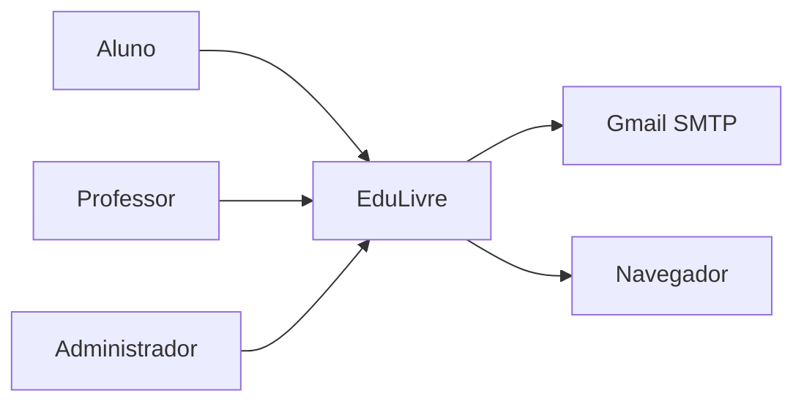
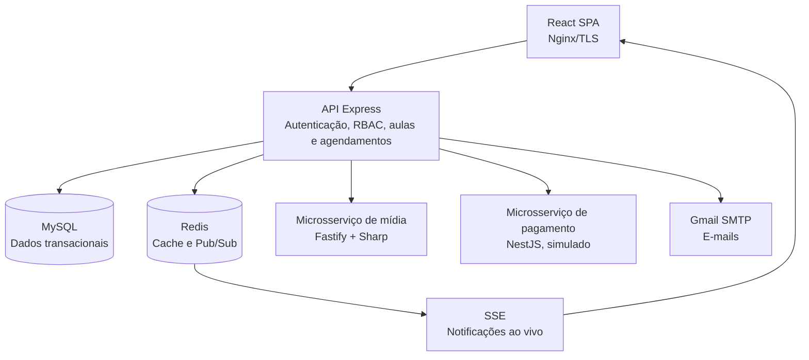

# Arquitetura do EduLivre

## C4 — Contexto

O EduLivre conecta alunos a professores particulares. Alunos pesquisam, contratam e pagam aulas; professores publicam e administram aulas; administradores moderam conteúdo e enviam comunicados operacionais.

## C4 — Contêineres

## Estilo e fronteiras de domínio

O núcleo é um **monólito modular**: API, regras de negócio e persistência compartilham o mesmo deploy para simplificar as transações de usuários, aulas, avaliações e agendamentos. As capacidades que têm perfil próprio de escala ou isolamento foram extraídas para microsserviços: otimização de imagem e processamento de pagamento simulado.

| Bounded context | Responsabilidades | Principais elementos |
| --- | --- | --- |
| Identidade e acesso | Cadastro, login, RBAC, recuperação de senha | `User`, `Role`, `Permission`, OTP de seis dígitos |
| Catálogo de aulas | Criação, imagens, busca, moderação e avaliações | `Aula`, `Avaliacao`, valor monetário |
| Agendamentos | Solicitação, aceite, recusa e pagamento | `Agendamento`, estado de reserva, estado de pagamento |
| Comunicação | Alertas persistentes e eventos ao vivo | `Notificacao`, Redis Pub/Sub e SSE |
| Mídia | Validação e conversão de imagens para WebP | Arquivo enviado, MIME type, tamanho |
| Pagamentos | Aprovação/recusa simulada e identificador de transação | `transactionId`, método Pix/cartão, valor |

### Entidades e value objects

- **Entidades:** usuário, aula, agendamento, avaliação, notificação, papel e permissão.
- **Value objects validados:** CPF, e-mail, senha forte, data de nascimento, valor monetário, status de agendamento e método de pagamento.
- **Invariantes:** somente o aluno dono paga; a aula deve estar aceita antes do pagamento; aula paga não pode ser recusada; e-mail não é alterável; usuários precisam ser maiores de idade para contratar/vender aulas.

## Modelo de dados e decisões

O MySQL é a fonte de verdade de usuários, aulas, reservas, avaliações, permissões e auditoria de pagamento. Redis não é banco de verdade: armazena cache de consultas com TTL e transporta eventos efêmeros. O microsserviço de mídia é stateless; o de pagamento simula a autorização e o serviço de agendamentos persiste o resultado auditável (`paymentTransactionId`, `paymentMethod`, `paymentPaidAt`).

## APIs e integração

O contrato dos endpoints principais está em [openapi.yaml](openapi.yaml). A API usa JWT Bearer, RBAC por permissões e validação de payload no servidor. Uploads são aceitos por Multer, validados e encaminhados internamente ao serviço de mídia com chave interna.

## ADRs

### ADR-001 — Monólito modular com microsserviços pontuais

- **Contexto:** regras de catálogo e agendamento são fortemente relacionadas, mas mídia e pagamento têm características próprias.
- **Decisão:** manter o núcleo no Express modular e separar mídia/pagamento em serviços Docker independentes.
- **Consequência:** simplicidade no domínio central e isolamento/escalabilidade nas integrações especializadas.

### ADR-002 — Redis para cache e eventos

- **Contexto:** listagem de aulas é frequente e avisos ao vivo não podem depender de polling.
- **Decisão:** cache com TTL e invalidação no Redis; Redis Pub/Sub para evento de aula criada; SSE autenticado para entregar ao navegador.
- **Consequência:** menor pressão no MySQL e atualização em tempo real. Mensagens Pub/Sub não são duráveis, portanto notificações críticas de moderação também são persistidas no MySQL.

### ADR-003 — Pagamento demonstrável sem processar cartão real

- **Contexto:** o projeto acadêmico precisa de checkout completo sem assumir responsabilidade financeira.
- **Decisão:** microsserviço NestJS simula Pix/cartão, recusa cartões de teste terminados em `0000` e nunca armazena PAN ou CVV.
- **Consequência:** fluxo auditável e seguro para demonstração; integração com gateway real é trabalho futuro.

### ADR-004 — SMTP via senha de aplicativo

- **Contexto:** e-mails de boas-vindas e recuperação de senha precisam funcionar sem domínio próprio no ambiente acadêmico.
- **Decisão:** Nodemailer com Gmail SMTP e senha de aplicativo guardada apenas em `.env`.
- **Consequência:** implantação simples; em produção deve-se migrar para domínio verificado e provedor transacional.
